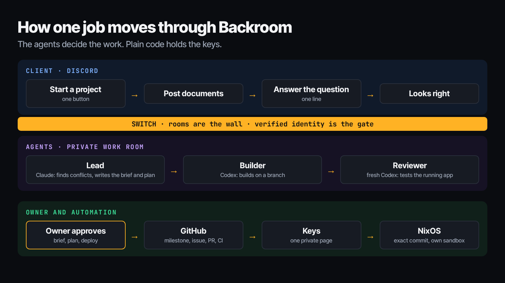
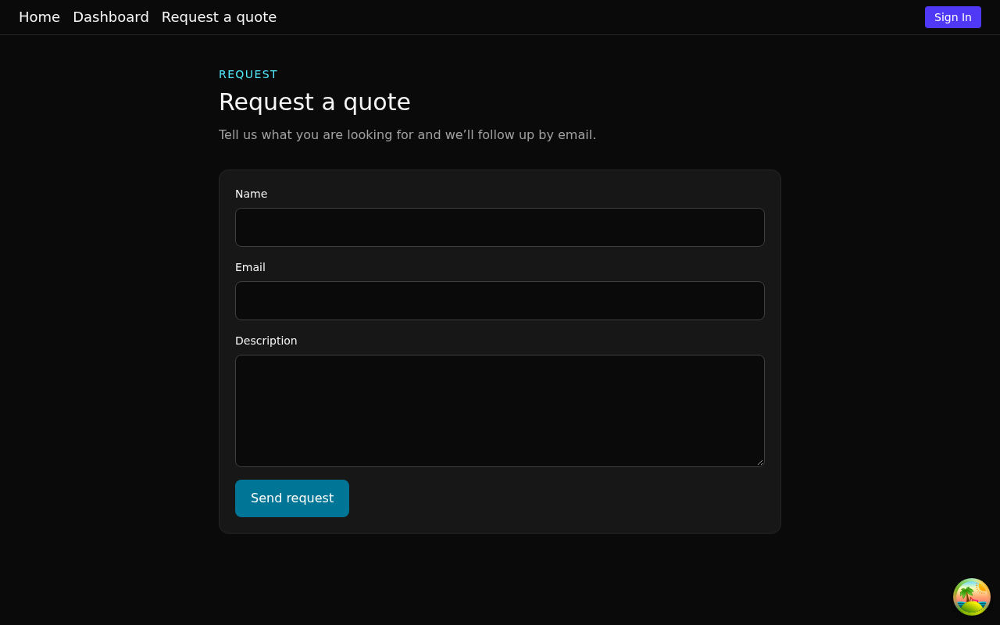
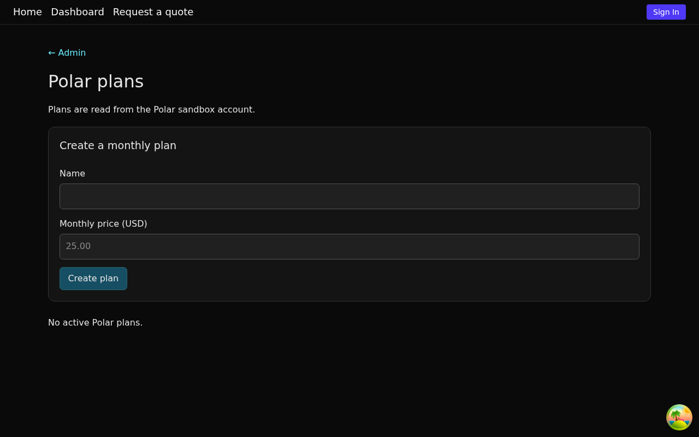
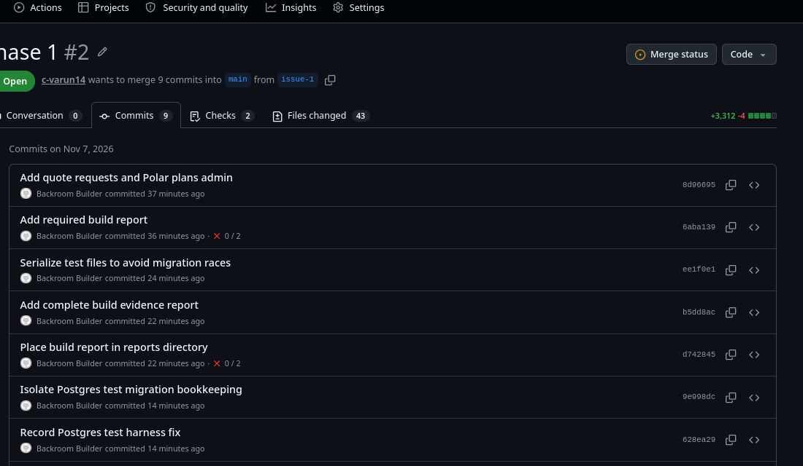
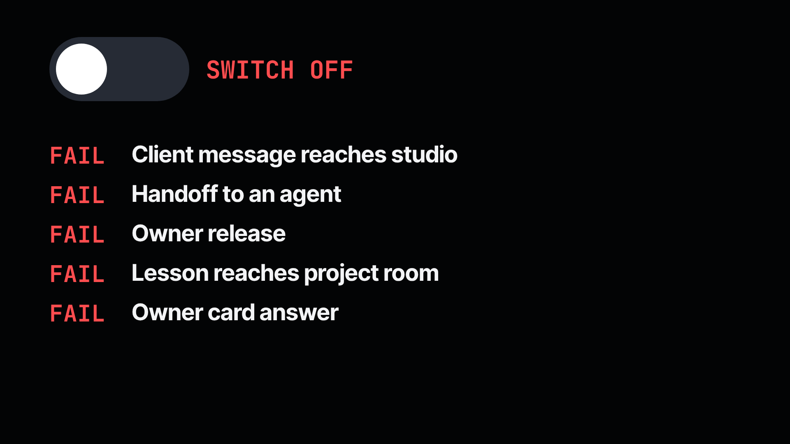

# Backroom

**One person. A whole AI agency. On Switch.**

I build apps for startups testing new ideas: usually under 1,000 users, with no reason to pay big cloud bills. Keeping costs tiny was the easy part. My databases run on [PgFy](https://github.com/c-varun14/pgfy), which I built at an earlier hackathon: 50 databases for $12 a month.

The work around each project was the hard part. Every new project meant environment variables, git setup, compose IDs and manual deploys, and agreeing one document took three to four days. I spent so long on that work that I started losing interest in building itself. So I moved the whole workflow into a chat, on Switch.

| | Before | With Backroom |
| --- | --- | --- |
| Agreeing a brief | 3–4 days of back and forth | 30 minutes, measured in a real run |
| New project setup | Manual git, compose and env work | One button, ready in 26 seconds |
| Carrying messages to agents | By hand, every time | Automatic, through Switch |
| Tracking progress | Manual | Milestone, issue, branch and pull request appear on GitHub by themselves |
| Deploying | Clicks and a build cycle | One tap deploys the exact reviewed commit on NixOS |
| Environment keys | Copied around by hand | One private page, one paste |



## What it does

A client starts a project in Discord with one button and posts their documents. An AI lead finds contradictions and asks about them, writes the brief, and writes a technical plan that only I see. A builder works on a branch. A separate reviewer, who never saw the builder's conversation, tests the running app and sends bugs back. The exact reviewed commit deploys on NixOS. Small safe changes are built to ship themselves; anything touching login, payments, data or configuration waits for me.

In a real run on real accounts, the lead caught two conflicts between client documents, including one nobody planted, and turned a one-line answer into the final brief. I am rolling Backroom out to production for a real client.

| The client's agreed quote form: no phone field | Polar plans in the admin dashboard |
| --- | --- |
|  |  |

GitHub fills itself in, with commits signed by a builder identity:



## How Switch is used

Without Switch, Backroom stops. `bash demo.sh` proves it: with Switch off, five real operations fail and nothing moves.

- **Agents connected:** Claude Code runs the front and lead roles. Codex runs the builder and the independent reviewer. A plain-code agent called desk connects through Switch's agent protocol and holds the approvals. Each role is one line in [`backroom.yaml`](backroom.yaml), so a better model is a one line change.
- **Channel setup:** Discord. Each project gets a private client forum and a post in the owner's studio forum, both bridged to Switch rooms. Agents work in a private work room and are not members of the client room. See the [live setup guide](docs/LIVE-SETUP.md), [server guide](docs/STUDIO-SERVER.md), and [keys guide](docs/APP-ENV.md).
- **Rooms are the wall:** when an agent tries to reach a client room, Switch refuses with HTTP 403.
- **Verified identity is the release gate:** an agent cannot approve itself.
- **Handoffs:** Claude passes work to Codex through Switch.

The agents decide the work. Plain code holds the keys.



## How to run it

Run the proof with no accounts:

```sh
bash scripts/repro/test-all.sh  # Bun 1.3.14 + Python 3; no network
bash demo.sh                  # Docker Compose; pulls pinned public images
bash demo.sh --down           # removes only the disposable demo stack
```

The demo runs real Switch, rejects unauthorized sends, deploys an exact reviewed commit, reopens approvals for a client revision, promotes a lesson through a package, refuses a second client access to the first client’s rooms and documents, then stops Switch and proves recovery. It generates a tiny disposable fixture in a temporary directory and writes its checks to `demo/out/receipt.html`. [Switch dependencies](docs/SWITCH.md) · [Live setup](docs/LIVE-SETUP.md).

## Security

Plain-code `desk` protects client messages, deployment approvals and lesson promotion. Verified owner identity authorizes exact frozen bytes, document versions and reviewed commit hashes; changed or replayed approvals cannot release new work. Private Switch rooms separate clients. Keys enter through signed, expiring, single-use links and write-only storage, with browser-origin checks and redacted diagnostics.

Verify the gates with `cd desk && bun test`, deployment boundaries with `bun test deploy`, and cross-client access refusals and outage recovery with `bash demo.sh`. [Adversarial checks](desk/tests/adversarial/checklist.md) · [Keys design](docs/APP-ENV.md) · [Server controls](docs/STUDIO-SERVER.md).

## Repository map

| Path | Purpose |
| --- | --- |
| `desk/` | Plain-code gates, workflow, Discord door, harness adapters and tests |
| `demo/` | Account-free Switch proof and temporary fixture generator |
| `deploy/` | Exact-commit deployers, runtime contracts and NixOS studio configuration |
| `docs/` | Setup, Switch proof, keys screenshot and submission drafts |
| `receipt/` | Scrubbed event receipt builder and tests |
| `scripts/` | Studio operations and offline reproduction checks |
| `studio-kit/` | Playbooks, approved memory, stack choices and video workflow |
| `switch/` | Tested version pins and private-room template |

## Limits

The filmed project, Cedar Studio, is a demo client. The zero-tap change path is covered by tests and has not yet run on real accounts. The account-free `demo.sh` uses scripted roles to prove the transport and gates. Environment keys are still added by a person, by design. Agents run on one server under a separate user, inside Codex's sandbox and systemd limits, not in a separate VM per agent. The narration in the video is AI-voiced.
