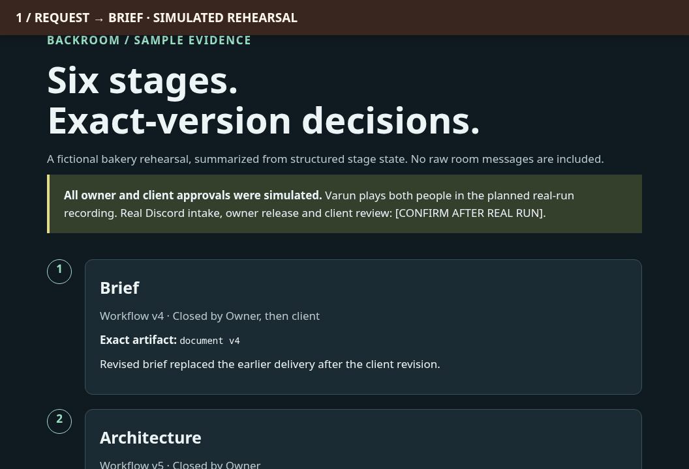

# Backroom

**A one-person agency that never makes the same mistake twice.**

Clients talk to one person in one chat. Behind that chat, AI teammates on [Switch](https://github.com/sandbox-quantum/switch) write the brief, build, review and deploy. The owner releases every step, and each approved lesson carries into the next project.

```sh
bash demo.sh
```

That one command needs only Docker. It starts a real Switch server, runs the workflow with scripted agents, then turns Switch off to show what breaks. It takes about 90 seconds once images are pulled, and needs no accounts.

- **Live sample app:** [Morrowcrumb Bakery](https://98-91-25-101.sslip.io/)
- **Proof page, no login:** [one client change, start to finish](https://98-91-25-101.sslip.io/proof/)



*Simulated rehearsal montage. Receipt evidence and a separate fresh local app run; no live client handoff is shown.*

## Quick answers

| Question | Answer | Check it |
| --- | --- | --- |
| Is Switch central? Would it stop working without it? | Yes. With Switch off, client messages don't arrive, handoffs stop, the owner can't be verified so nothing is released, and lessons can't reach a project. Each is a real failed call, followed by recovery | `bash demo.sh`, and [how Backroom uses Switch](docs/SWITCH.md) |
| Does it run? Can someone clone and reproduce it? | Yes. One command runs 17 live checks against a real Switch server, and `bash scripts/repro/test-all.sh` runs the code suite | |
| Is it a fresh idea for a real problem? | A small agency owner spends the day carrying messages between clients and AI tools. Backroom removes the carrying but keeps the owner's decision, and lessons learned on one project improve the next | [Six stages](#six-stages) |
| How is Switch used? | Rooms are the wall, handoffs run through mentions and documents, verified sender identity is the release gate, and packages carry memory | [Feature table](docs/SWITCH.md) |

A solo agency owner is tired of carrying conflicting client documents between people and AI tools. The client talks only to plain-code `desk`, which forwards work into a private Switch studio. `lead` writes the plan, `builder` builds it, a fresh `reviewer` checks it, and nothing reaches the client until the owner releases that exact version.

## Verify after cloning

With Docker and Compose installed, run the account-free Switch demo:

```sh
bash demo.sh
```

It pulls pinned Switch 0.31.0 images anonymously, provisions disposable native
SAMPLE accounts and private rooms from the template, and runs the real desk
against real Switch. Role CLIs and human decisions are explicitly scripted;
there are no AI/model calls. It checks rejected sends, a reviewed exact-commit
bakery deployment, a client revision, and a package promotion. It then stops
Switch, attempts four operations, prints their real errors, restarts Switch,
and checks recovery. Open `demo/out/receipt.html` and the printed loopback bakery
URL. The synthetic video is only an exact-file gate fixture. This demo does not
prove AI reasoning or production video quality. [Demo details](demo/README.md).

`bash demo.sh --down` removes only the `backroom-judge-demo` containers, network
and volumes. No host Bun, Python, accounts or keys are needed for this demo.

For the separate Docker-free test suite:

Install **Bun1.3.14** ([official versioned-install instructions](https://bun.sh/docs/installation#installing-older-versions)), Bash and Python3, then run from the repository root:

```sh
bash scripts/repro/test-all.sh
```

No dependency install, AI login, Discord, Switch server, Docker or network access is needed for this suite. It tests a temporary source copy with an empty HOME/environment; existing credentials and runtime state are not used. Checks cover desk gates/stage versions/adapter fixtures, secret-scrubbed receipts, adversarial log effects, runtime-contract validation, bakery storage/time/capacity rules, the earlier-shop privacy fix and the pinned template's static policy. Exact command output and timing are in . Passing fixtures do not establish live human approvals or model compliance.

The public tree must contain **regular source files** under `rehearsal/bakery/` and `sample-projects/old-shop/`; no nested Git history, credentials or empty gitlinks are needed. See . A source-copy self-check is `bash scripts/repro/verify-clean.sh`; publication-normalized verification adds `--public`.

For a product-only demo, run `bun --no-env-file rehearsal/bakery/demo.ts` and open its printed localhost URL. It starts a fresh fictional database using the real clock. Full optional Switch/Discord setup and its manual prerequisites are in [LIVE-SETUP](docs/LIVE-SETUP.md). The existing service helpers are not a clean-clone installer.

## Six stages

| Stage | Work | Who closes it |
| --- | --- | --- |
| Brief | Translate messy documents, retain conflicts, freeze an identified brief | Owner releases it; client approves that version |
| Architecture | Choose a small stack and cite approved lessons | Owner |
| Build | Brand, implement, fresh review, exact-commit local deploy | Owner |
| Client review | Deliver the approved link; questions stay open, changes create versions | Client accepts the deployed commit |
| Video | Produce a walkthrough only on request; review its exact file hash | Owner, then client |
| Learn | Propose de-identified lessons; promote only approved versions; separately authorize older-project fixes | Owner |

Questions preserve the stage. Suggestions create a version. Scope changes reopen affected later approvals. All its owner/client commands were SIMULATION actions. The  covers the pickup-session model change with same-session implementation/review. Block2's native revision loop concerns the confirmation heading; these are separate checks.

## How Backroom uses Switch

See [docs/SWITCH.md](docs/SWITCH.md) for each feature, its job, and its failing case.

## What lives outside Switch

Git holds source, [studio playbooks](studio-kit/agents/), [sample lessons](studio-memory/), and [projects.yaml](projects.yaml). Desk keeps SQLite send intents/deduplication/stage state locally. Docker Compose owns local app deployment, port leases and persistent volumes; the bakery's SQLite stores orders. File-mounted runtime credentials, provider login state, video tooling and static HTML receipts live outside Switch. A lesson file enters room context only after the operator attaches its approved package version.

## Limits to keep with the result

- Everything here uses a **fictional client** and sample data. Native rehearsal owner/client approvals are **simulated**. Human Discord intake, linked-owner release and client review were not proved by bot activity; Discord card/attachment rendering remained unverified.
- Same-machine CLI agents are **not a strong sandbox**. Separate Switch owners/private rooms mitigate the demonstrated room breach, but do not isolate an OS user.
- Client app deployments in the workflow are **localhost-only**, with downtime and incomplete crash/migration rollback. A passing health check alone does not prove configured readiness or durability. . The public sample app is a separate fictional demo on a small [NixOS host](deploy/nixos/configuration.nix), with no secrets or AI logins on it.
- The final reviewer identity/session was fresh, but the final review was bounded to its stated finding and historical room context could remain visible. A local fix branch/description is not a submitted PR.
- Generated videos, the accepted live workspace, raw room histories and runtime state stay local. The [public proof page](receipt/public.html) exports the fictional request, approved versions/reply, exact reviewed deployment, embedded bakery screenshot, blocked-send reason and older-project diff without requiring those files. The bundled sample receipt remains a separate fixture. The reported video had technical QC, but no human listening/ASR pass.
- The registry can lag the later local fix; use the exact evidence/code under test rather than treating its original fixture status as current release authority. No clean-copy test establishes a complete real-client deployment or universal prompt-injection resistance.

## Public proof without an account

Open [receipt/public.html](receipt/public.html) directly. [docs/index.html](docs/index.html) embeds the same self-contained page so GitHub Pages can publish from the `/docs` folder, with no build or backend. Pages hosting has not been enabled by this task. All evidence uses fictional data and labels simulated approvals; source-run notes keep the native rehearsal, gate probe and hand rehearsal separate.
